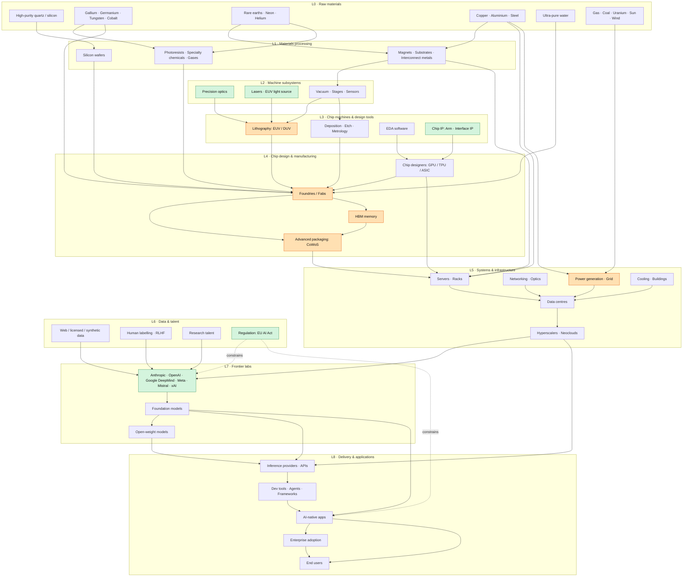

# EU AI

A small project to understand where Europe sits in the AI industry stack.

## Inspiration

This started from Stubb's talk (click the thumbnail to watch, it opens at 13:14):

## Approach

1. **Visualize the stack.** Map the AI industry as a dependency tree, like a civilization tech tree. It runs from raw materials (rare elements, metals) through chip machines, chips, data centres and frontier labs, up to applications and end users. The diagram is embedded below and lives in [`ai_stack_tech_tree.md`](ai_stack_tech_tree.md).
2. **Look at the EU companies that contribute to it.** With the stack laid out, place European companies on the layers they serve, and see where Europe is strong and where it depends on others. The diagram already highlights a few starting points, such as lithography, optics, lasers, chip IP and frontier labs. See [`eu_companies_by_layer.md`](eu_companies_by_layer.md) for the 451 companies found so far, with a confidence rating on each.

## The stack

Arrows read as "is required by". Green marks a strong European position, orange a current bottleneck, and dotted arrows regulatory influence.

## Files

| File | What it is |
|------|------------|
| `ai_stack_tech_tree.md` | Mermaid dependency tree of the AI stack, with EU strengths (green) and bottlenecks (orange) |
| `companies.json` | Source of truth: 451 European companies with layer, location, role, confidence and notes |
| `build.py` | Regenerates the three files below from `companies.json` (`python3 build.py`) |
| `eu_companies_by_layer.md` | The companies as one table per layer |
| `eu_companies.geojson` | Map of those companies at their headquarters. GitHub renders it as an interactive map |
| `eu_map.html` | Same map as a standalone page with clustering, a toggle per layer and a low-confidence filter. Open it locally, GitHub shows only the source |

## Viewing the diagram

The diagram renders inline on GitHub. In VS Code, use a Mermaid preview extension.

## Status

The stack diagram is a simplified first pass. The company list is not exhaustive, and most entries are not yet verified against live sources (see the confidence column).
