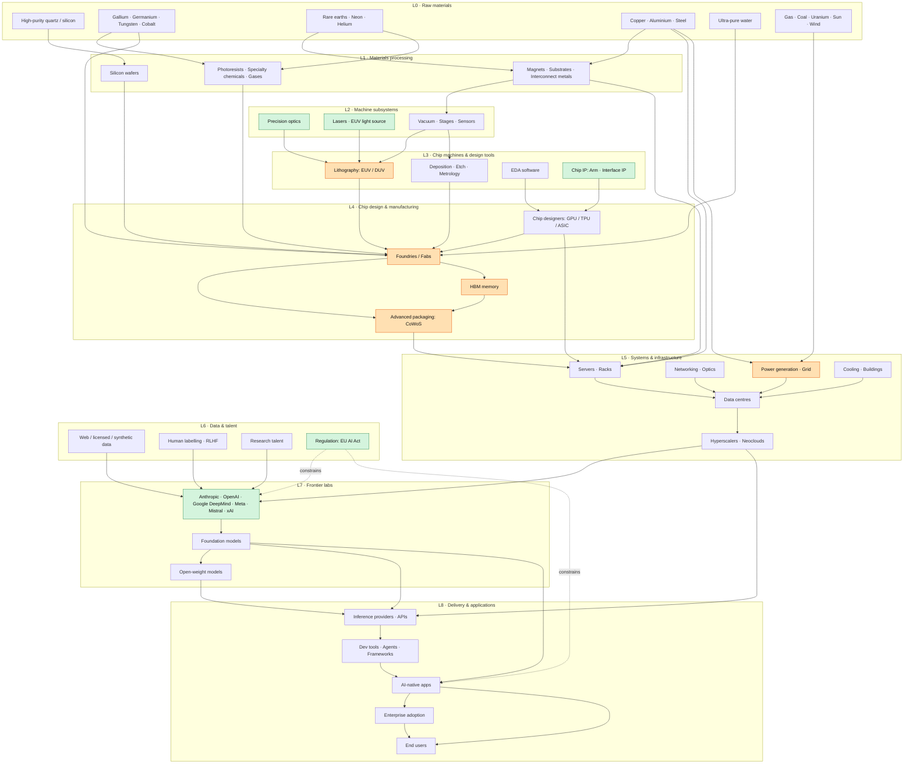

# AI Industry Stack: Dependency Tree

Arrows read as "is required by" (dependency → dependent). Read top to bottom: the top is the foundation, the bottom is what people actually use.
Green nodes mark where Europe holds a meaningful position.

## Legend

- **Green**: strong European position (Zeiss optics, Trumpf lasers, ASML lithography, Arm-adjacent IP, Mistral (inside the Labs node), the EU AI Act as regulator).
- **Orange**: widely considered current bottlenecks (EUV lithography, advanced packaging, HBM, leading-edge fabs, grid power).
  Litho (ASML) is European but rendered orange, because it is the sharpest bottleneck.
- **Dotted arrows**: regulatory influence, not a physical dependency.

## How to read the tree

| Layer | Question it answers |
|-------|---------------------|
| L0 | What has to be dug up or extracted? |
| L1 | What must be refined before it is useful? |
| L2–L3 | What machines and tools make chips possible? |
| L4 | Who designs and builds the chips? |
| L5 | Where do the chips run, and what powers them? |
| L6 | What else do labs need besides compute? |
| L7 | Who trains the models? |
| L8 | How does it reach people? |

## Notes

- Simplified on purpose. Real dependencies are many-to-many (for example, every fab also needs EDA-driven design rules, and HBM makers need their own lithography).
- Company names are illustrative examples of each layer, not an exhaustive list.
